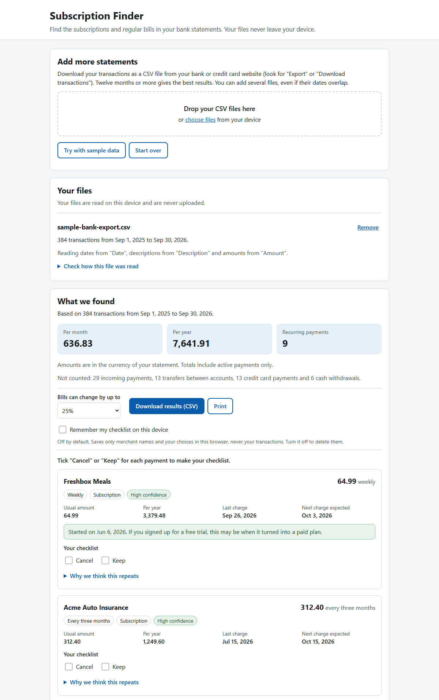

# Subscription Finder

Find the subscriptions and recurring bills in your bank and credit card CSV exports. Free, open
source, and private: everything runs in your browser.

**Open it here: <https://macemek.github.io/subscription-finder/>**



## How to use it

1. On your bank or credit card website, download your transactions as a CSV file. The option is
   usually called "Export" or "Download transactions". Twelve months or more gives the best
   results.
2. Open the site and drop the files onto the page, or choose them. You can add several files,
   even if their dates overlap.
3. Check the results. For each recurring payment you see how often it is charged, the usual
   amount, the last charge, the next expected charge and the cost per year. Price increases,
   double charges and recently started subscriptions are pointed out.
4. Tick "Cancel" or "Keep" to make a checklist, then download it as a CSV file or print it.

To look around first, press "Try with sample data", or open
<https://macemek.github.io/subscription-finder/#sample>. The sample is made-up data.

## Privacy

- Your files are read and analyzed in your browser. There is no server, no account, no
  analytics, no cookies, and nothing is loaded from other websites (no fonts or CDNs).
- The page has a strict Content-Security-Policy:
  `default-src 'none'; script-src 'self'; style-src 'self'; img-src 'self' data:; connect-src 'none'; form-action 'none'; base-uri 'none'; object-src 'none'`.
  `connect-src 'none'` blocks every network request, so the page cannot send your data anywhere.
- Nothing is saved unless you turn on "Remember my checklist on this device". That saves only
  merchant names and your choices in your browser's local storage, never your transactions.
  Turning it off deletes them.
- Once the page has loaded it needs no network at all, so you can go offline and keep using it.
  There is no service worker: nothing is installed or cached beyond the browser's normal cache.

### How to check this yourself

1. Open the browser's developer tools (F12) and the Network tab, then add a file. No new
   requests appear.
2. View the page source and find the `Content-Security-Policy` meta tag.
3. Read the code in `src/`. `test/dist.test.ts` checks every build for links to other sites and
   for network APIs.

## Supported files

- CSV files separated by commas, semicolons or tabs, in UTF-8 (with or without a byte order
  mark), UTF-16 with a byte order mark, or Windows-1252.
- The header row can be anywhere in the first 30 rows. Column names are recognized in English,
  German, French, Spanish, Dutch, Portuguese and Italian. If there is no header row or a column
  is missing, you pick the columns yourself.
- Dates like `2026-01-05`, `20260105`, `01/05/2026`, `05/01/2026`, `05.01.2026`, `05.01.26`
  and `Jan 5, 2026`. Whether `01/05` means January 5 or May 1 is decided from all rows, and you
  can change it.
- Amounts with a minus sign, in separate money out and money in columns, with a "Debit" /
  "Credit" (or "Af" / "Bij") column, in parentheses, with currency symbols, thousands separators
  or a decimal comma (`1.234,56`). Card exports that show purchases as positive numbers are
  detected, and you can switch this.
- Excel, PDF, OFX and QIF files are not supported. Export a CSV file instead.

`test/fixtures/csv` has made-up files in the layouts of common bank and card exports.

## How detection works

1. **Left out first:** money coming in, transfers between your own accounts, credit card
   payments and cash withdrawals. The keyword rules are in `src/detect/exclude.ts`.
2. **Merchant names** are cleaned up: payment processor prefixes (`SQ *`, `TST*`, `PAYPAL *`),
   card and store numbers, phone numbers, dates, transaction IDs and city or state codes are
   removed. A short alias list joins a few very common services whose names vary between banks.
3. **Double charges:** the same amount from the same merchant within three days is shown as
   "Charged twice" and counted once.
4. **How often:** the typical gap between charges picks the cadence, then the app takes the
   latest run of charges whose gaps all fit it.

   | How often          | Days between charges | Charges needed | High confidence                 |
   | ------------------ | -------------------- | -------------- | ------------------------------- |
   | Weekly             | 5 to 9               | 4              | 6 or more, every gap 6 to 8     |
   | Every two weeks    | 12 to 16             | 3              | 5 or more, every gap 13 to 15   |
   | Monthly            | 26 to 35             | 3              | 4 or more, every gap 27 to 34   |
   | Every three months | 84 to 98             | 2 within 5%    | 3 or more, every gap 87 to 95   |
   | Yearly             | 350 to 380           | 2 within 5%    | 3 or more, every gap 358 to 372 |

   A pattern of only two charges needs a gap in the narrow range and amounts within 5% of each
   other, and always has medium confidence.

5. **Subscription or bill:** if the amount stays the same (changes up to 2% are ignored, and a
   step up is a price increase), it is a subscription. Otherwise it is a bill, which must be
   monthly or rarer, include at least two thirds of the merchant's charges, and stay within the
   bill tolerance (25% by default, adjustable to 10% or 50%) of the usual amount.
6. **Possibly stopped:** no charge for longer than the longest allowed gap plus 7 days before the
   end of your files. These are listed separately and left out of the totals.
7. **Started recently:** the pattern began well after your files start and has no earlier
   charges. This can be a free trial that turned into a paid plan. Small "trial" or verification
   charges are not used, because they are usually reversed and often never appear in exports.
8. **Totals:** the usual amount times 52, 26, 12, 4 or 1 per year, and the yearly total divided
   by 12 per month.

Every result has a "Why we think this repeats" section with the dates and amounts it is based on.

## Limitations

- Subscriptions billed through the App Store, Google Play or PayPal often show up as one combined
  charge, or not at all. Check those accounts separately.
- Yearly subscriptions only show up with more than a year of transactions.
- Amounts in different currencies are not converted.
- The results are suggestions. Check them before you cancel anything.

## Local development

You need Node.js 22.12 or later (`.nvmrc` says 24).

```bash
npm ci
npm run dev       # http://localhost:5173/subscription-finder/
npm run all       # format check, lint, type check, tests and build, like CI
npm run build
npm run preview   # serves dist/ at http://localhost:4173/subscription-finder/
```

The development server runs without the Content-Security-Policy because hot reloading needs inline
styles; `npm run build` adds it. Pushing to `main` deploys `dist/` to GitHub Pages.

## License

[MIT](LICENSE)
